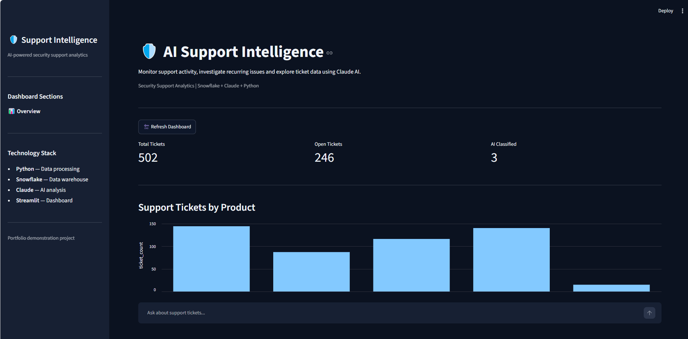

# AI Support Intelligence Platform

An end-to-end support analytics platform built with Python, Snowflake, Claude AI and Streamlit.

The platform processes fictional technical support tickets, stores them in a cloud data warehouse, uses AI to classify support issues, and provides an interactive dashboard with natural-language analysis.

The project demonstrates data engineering, SQL analytics, API integration, AI agent development and dashboard design.

## Dashboard Preview



## Key Features

### Data Pipeline
- Generates 500 synthetic technical support tickets.
- Cleans and validates ticket data using Python.
- Loads records into Snowflake.
- Uses SQL MERGE operations to prevent duplicate ticket IDs.
- Supports repeatable ingestion.

### AI-Powered Classification
- Uses the Anthropic Claude API to classify support tickets.
- Identifies issue categories, likely causes and recommended actions.
- Produces structured JSON responses with confidence scores.
- Validates AI output before storing results in Snowflake.
- Avoids reclassifying previously processed tickets.

### Read-Only AI Agent
- Answers natural-language questions about support data.
- Uses Claude tool calling to access approved reporting functions.
- Queries Snowflake through a restricted read-only role.
- Limits tool calls and validates tool inputs.
- Does not allow Claude to execute arbitrary SQL.

### Interactive Dashboard
- Displays live Snowflake ticket metrics.
- Visualises product, priority and status breakdowns.
- Provides interactive product and priority filters.
- Displays monthly ticket trends with date filtering.
- Exports filtered aggregated data to CSV.
- Includes a Claude-powered chat interface.
- Uses Streamlit caching to reduce unnecessary database queries.

## Technology Stack

| Technology | Purpose |
|---|---|
| Python | Data processing and automation |
| Snowflake | Cloud data warehouse and SQL analytics |
| Anthropic Claude | AI classification and tool-calling agent |
| Streamlit | Interactive web dashboard |
| Pandas | Data manipulation and reporting |
| Pytest | Automated testing |
| Git / GitHub | Version control and project documentation |

## Architecture

```text
Synthetic Ticket Generator
          |
          v
Python Data Cleaning
          |
          v
Snowflake RAW.SUPPORT_TICKETS
          |
          +----------------------+
          |                      |
          v                      v
AI Classification          SQL Reporting
(Claude API)               and Aggregation
          |                      |
          v                      |
Snowflake AI Results             |
          |                      |
          +-----------+----------+
                      |
                      v
             Streamlit Dashboard
                      |
                      v
               Claude AI Agent
                      |
                      v
          Approved Read-Only SQL Tools
                      |
                      v
                 Snowflake
```

## Project Structure

```text
AI Support Platform/
├── dashboard/
│   └── app.py
├── data/
│   ├── raw_tickets.csv
│   └── cleaned_tickets.csv
├── src/
│   ├── generate_data.py
│   ├── clean_data.py
│   ├── analyse_data.py
│   ├── database.py
│   ├── ingest_tickets.py
│   ├── classify_ticket.py
│   ├── classify_pipeline.py
│   ├── agent_tools.py
│   └── support_agent.py
├── tests/
├── docs/
│   └── screenshots/
│       └── dashboard-overview.png
├── .streamlit/
│   └── config.toml
├── .env.example
├── .gitignore
├── requirements.txt
└── README.md
```

## Getting Started

### Prerequisites

- Python 3.11 or newer
- A Snowflake account with the required database objects
- An Anthropic API key
- Git

### Installation

Clone the repository:

```bash
git clone https://github.com/YOUR_USERNAME/YOUR_REPOSITORY.git
cd YOUR_REPOSITORY
```

Create and activate a virtual environment:

```powershell
python -m venv .venv
.\.venv\Scripts\Activate.ps1
```

Install dependencies:

```powershell
python -m pip install -r requirements.txt
```

Create a `.env` file using `.env.example` as a template and supply your own credentials.

**Note:** The application requires the Snowflake tables, reporting views and read-only role described in the architecture. Database provisioning is not yet automated, so a fresh clone will not run without configuring these objects.

### Launch the Dashboard

```powershell
python -m streamlit run dashboard/app.py
```

### Run Tests

```powershell
python -m pytest -v
```

## Security and Design Decisions

- Credentials are loaded from environment variables and excluded from Git.
- The AI agent is limited to predefined reporting functions.
- Snowflake access uses a dedicated read-only role for agent queries.
- Tool inputs and AI classification responses are validated.
- AI tool calls are capped to prevent uncontrolled execution.
- The dataset is synthetic and contains no real customer information.

## Current Limitations

- Snowflake authentication uses an interactive Google OAuth flow.
- The dashboard currently runs locally.
- Dashboard date filters apply to monthly trends rather than all metrics.
- The chat interface displays conversation history, but individual agent requests are processed independently.
- The dashboard requires a configured Snowflake environment.
- AI classifications are suggestions, not verified technical diagnoses.

## Future Improvements

- Public demonstration mode using synthetic data.
- Unified filters across all charts and exports.
- Automated database setup and migrations.
- CI/CD testing through GitHub Actions.
- Improved monitoring and error logging.
- Deployment with authentication and API usage limits.

## About This Project

This project was developed as a practical exercise in combining traditional data analytics with modern AI workflows.

The support ticket scenarios are based on common issues encountered in CCTV, alarm, intercom and networking environments.

The goal was to build a working system that moves data from ingestion through analysis and presents useful information to support teams.

## Disclaimer

All ticket data is fictional and generated for demonstration purposes. AI-generated classifications and recommendations should be reviewed before use in real technical support environments.
